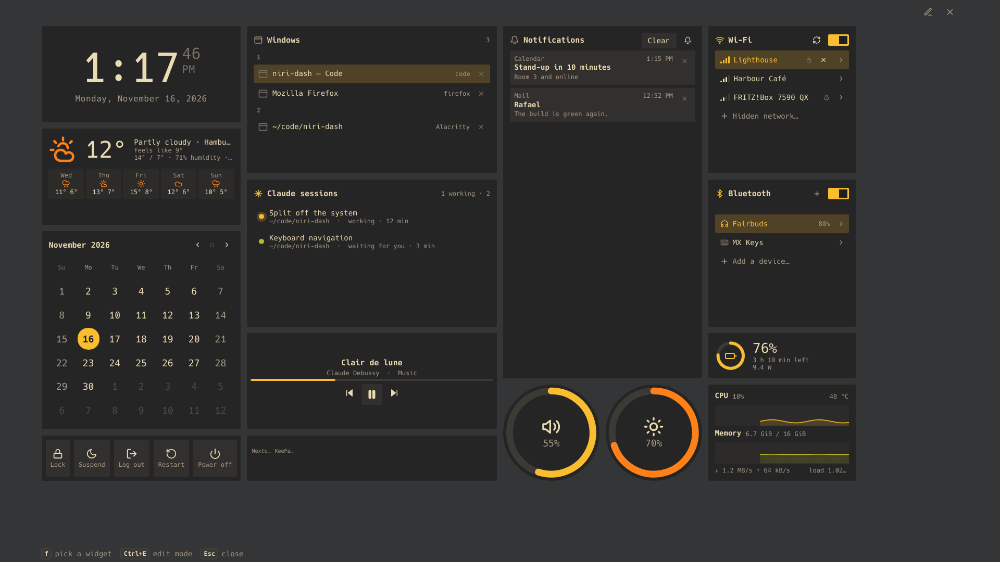
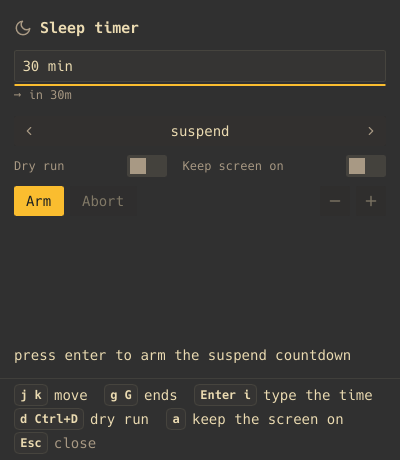
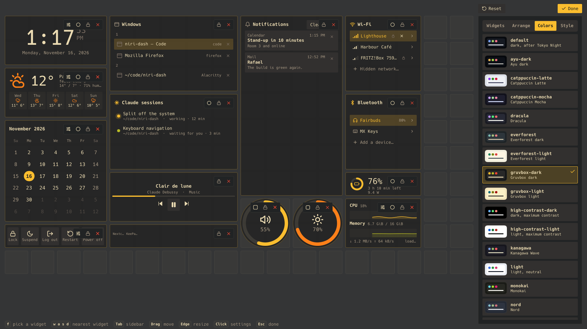
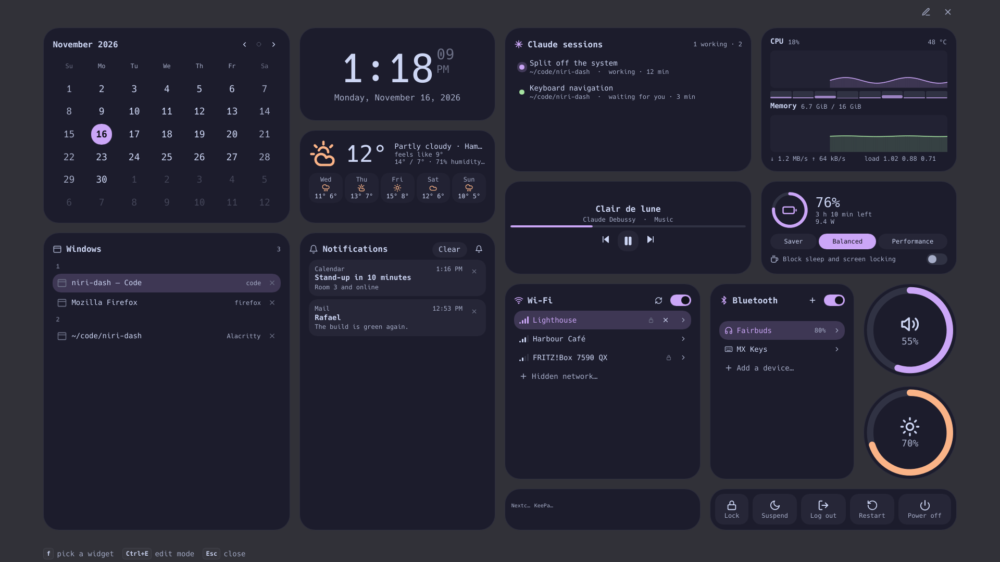
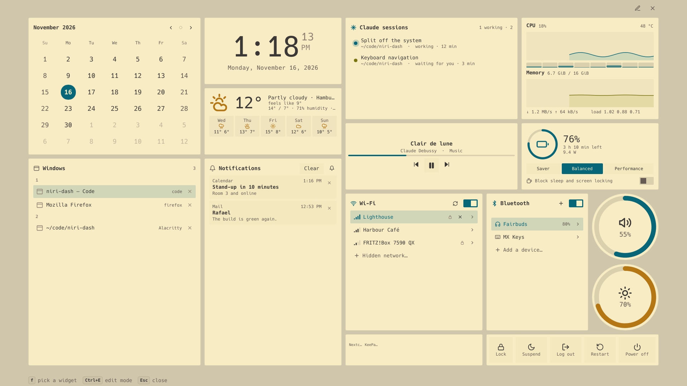
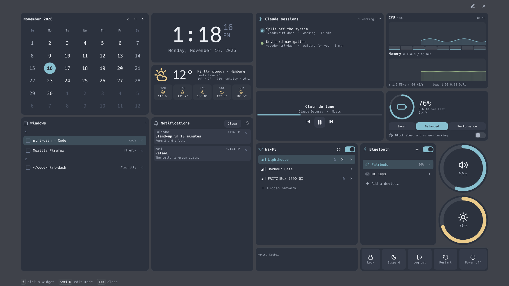
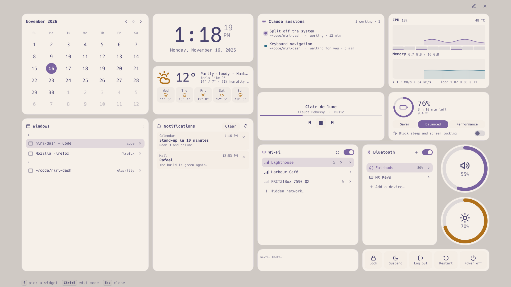
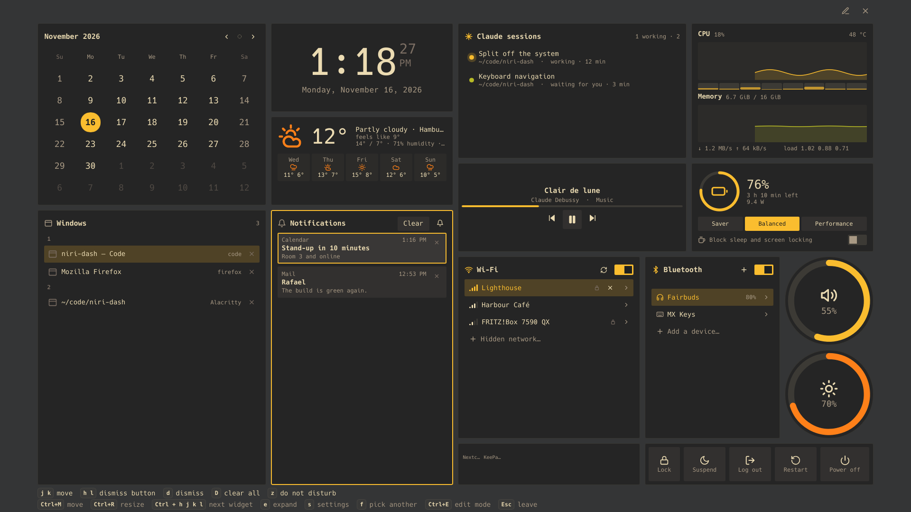

# niri-dash

A fullscreen widget dashboard for the [niri](https://github.com/YaLTeR/niri) Wayland compositor
and for KDE Plasma 6. One key brings it up over everything; another press, Escape or a click on the
background puts it away.

[](https://slint.dev)



**[Try it in your browser](https://barafael.github.io/niri-dash/)** · **[Read the manual](https://barafael.github.io/niri-dash/manual/)**

The browser version is the same dashboard on a simulated system.

- **One overlay, on demand.** A single daemon draws a layer-shell overlay with
  [Slint](https://slint.dev), on the GPU or in software. Hidden, it renders nothing and its data
  sources go quiet.
- **Widgets for the whole desktop.** Most come in a rectangular and a round shape, and any one
  runs on its own as a small window: `niri-dash app clock`.
- **Yours to arrange.** Drag, resize, restyle, recolor. The layout is a plain text file.
- **Works without a mouse**, and always shows which keys do what.

## Widgets

| | |
|---|---|
| **Time** | Clock, calendar, weather (Open-Meteo, no API key), timer, stopwatch, pomodoro, sleep timer |
| **Activity** | Windows by workspace, notifications, clipboard history, sticky notes, Claude Code sessions and usage, a mascot, an About card |
| **Media** | Now playing (MPRIS) |
| **System** | CPU, memory, disks, network and GPU, battery and power profiles, privacy (who uses the microphone, camera or screen) |
| **Devices** | Wi-Fi, Bluetooth, removable drives, phone (KDE Connect) |
| **Controls** | Volume, brightness, night light, system tray, session (lock, suspend, log out, …), keyboard layout, color picker |

Sizes and settings of each are in the [widget reference](https://barafael.github.io/niri-dash/manual/reference/widgets/index.html).



*`niri-dash app sleep-timer`: a widget as its own window.*

## Edit mode



The pencil in the corner (or a right-click on the background) opens it. Drag widgets, resize them
from any edge, add more from the sidebar. The sidebar also sets the grid, the color scheme and the
style, and its Arrange tab lays the widgets out by itself (experimental).

Color schemes and styles are separate, and mix freely:

| catppuccin-mocha, soft | gruvbox-light, sharp |
|---|---|
|  |  |
| **nord, compact** | **rose-pine-dawn, default** |
|  |  |

The pictures above the table are gruvbox-dark with the sharp style and the Hack font.

## Keyboard



`f` labels every widget; typing a label goes into that widget. The two lines along the bottom
list every key that works just now: the widget's own above, the dashboard's below. A key that
isn't listed does nothing. `e` blows a widget up, Ctrl+M moves it, Ctrl+R resizes it, Ctrl+E opens
edit mode, Escape steps back. The [keyboard reference](https://barafael.github.io/niri-dash/manual/reference/keyboard.html)
has all of them.

## What it reads

- **Clipboard history is opt-in.** niri-dash reads what you copy only while a clipboard widget is in
  your layout or `niri-dash app clipboard` is running. The history stays in memory and skips what
  password managers mark secret.
- **The Claude usage widget reads only local files:** session transcripts in `~/.claude/projects`
  for the token counts, and two plan fields of `~/.claude.json`. It never opens the file with your
  login tokens.
- **The weather widget is the only one that makes network requests of its own** (to Open-Meteo).

[SECURITY.md](SECURITY.md) says what else niri-dash touches, and how to report a problem.

## Where it runs

| | Tested with | Notes |
|---|---|---|
| niri | 26.04 | Built against `niri-ipc` 26.4. Other releases may work; the IPC is only versioned with niri itself. |
| KDE Plasma | 6.8 | Plasma 6 only. [Some widgets don't work there.](#on-kde-plasma) |
| Rust | stable | 1.95 or newer (the `kdl` crate needs it). CI builds with the latest stable and with 1.95. |
| Browser | any with WebGL 2 | For the web version only. |

## Where to get it

Needs a Rust toolchain, and the usual Wayland, EGL, fontconfig and xkbcommon libraries.

```sh
cargo install --path . --locked
```

### On niri

```kdl
spawn-at-startup "niri-dash"

binds {
    Mod+N { spawn "niri-dash" "toggle"; }
}
```

### On KDE Plasma

Start `niri-dash` at login (System Settings → Autostart), and bind a key to `niri-dash toggle`
(System Settings → Keyboard → Shortcuts → Add New → Command or Script). Run
`niri-dash desktop-entries` once for the window list.

Plasma keeps showing notifications; the notification widget pauses its pop-ups, and the history
there is a copy of what Plasma was sent since niri-dash started. Night light, keyboard layouts, the
color picker, logging out and going to a Claude session's window go through Plasma; a session in
Konsole gets its tab brought up too. Noticing screen sharing needs niri. The manual lists
[what else differs](https://barafael.github.io/niri-dash/manual/reference/plasma.html).

`niri-dash --help` lists the other commands: `inhibit`, `dnd`, `night-light`, `say`, ….

## Where it keeps things

| What | Where |
|---|---|
| Layout and settings | `~/.config/niri-dash/config.kdl`, which edit mode writes back with your comments intact |
| Color schemes and styles | `colorschemes/` and `styles/` next to it, as KDL files; add your own |
| Saved state | `niri-dash/state.json` in `$XDG_STATE_HOME` (usually `~/.local/state`) |

`~/.config` is `$XDG_CONFIG_HOME` where that is set. The manual lists
[every file and environment variable](https://barafael.github.io/niri-dash/manual/reference/environment.html).

## Developing

The web version builds for the browser against a simulated system instead of the real one
(`crates/system/src/sim`). On the desktop, `NIRI_DASH_SIM=1` runs on the same simulation.

```sh
rustup target add wasm32-unknown-unknown
cargo install trunk --locked
trunk serve
```

The manual is an [mdBook](https://rust-lang.github.io/mdBook/) in `book/`: `mdbook serve book`. Its
widget tables are written from the source by a test (`cargo test --lib book`; see `src/book.rs`),
and its screenshots by `book/screenshots.sh`.

A push to `main` runs the tests, and builds the web version and the manual and puts them on GitHub
Pages (`.github/workflows/`).

## License

MIT or Apache-2.0, at your option.

niri-dash is built with [Slint](https://slint.dev), used under its [Royalty-free Desktop, Mobile,
and Web Applications License](https://github.com/slint-ui/slint/blob/master/LICENSES/LicenseRef-Slint-Royalty-free-2.0.md).
That license asks for attribution, which is the "Made with Slint" badge at the top of this page and on
the [web version](https://barafael.github.io/niri-dash/). If you redistribute niri-dash or a fork,
keep a badge on a public page where it can be found, or add Slint's `AboutSlint` widget to an About
screen; or use Slint under the GPL-3.0 instead.

`patches/i-slint-renderer-software` is a lightly patched copy of Slint's software renderer (see
its README) and keeps Slint's own licenses, in its `LICENSES` directory.
