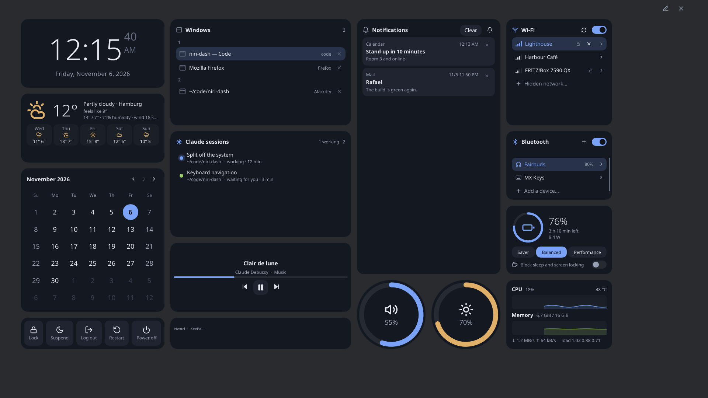
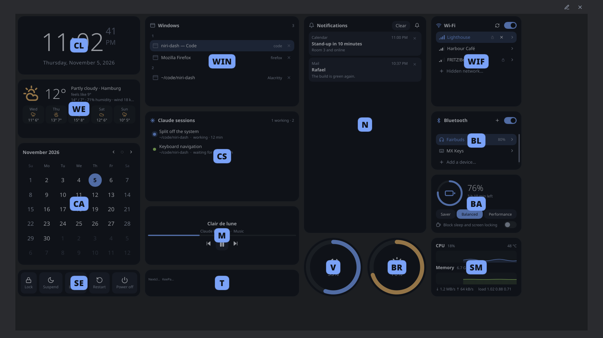
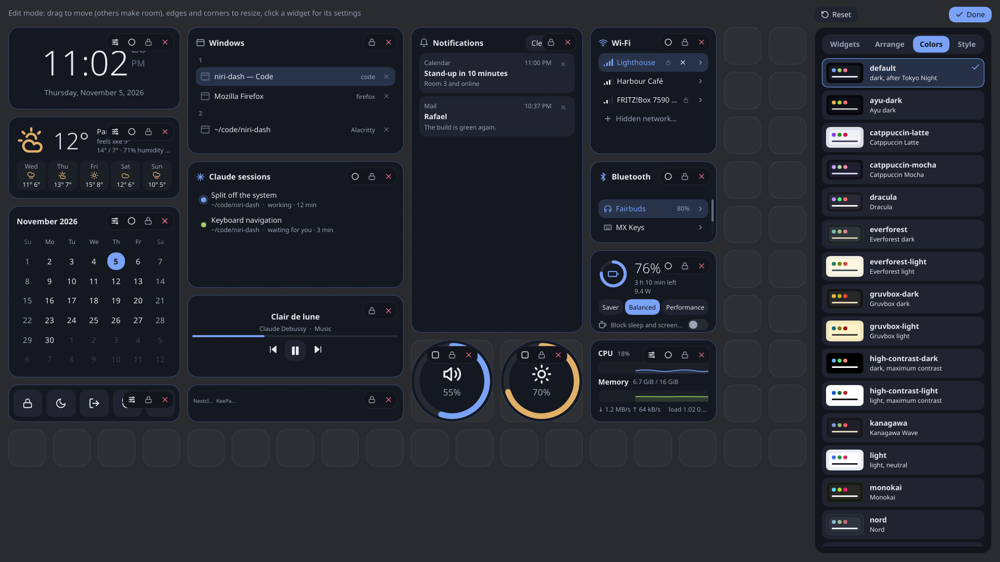

# niri-dash

A fullscreen widget dashboard for the [niri](https://github.com/YaLTeR/niri) Wayland compositor,
and for KDE Plasma 6. One key brings it up over everything; another press, Escape or a click on
the background puts it away.

It is a single daemon: a layer-shell overlay drawn with [Slint](https://slint.dev), on the GPU
through EGL (or in software). While hidden it renders nothing and its data sources go quiet.

[](https://slint.dev)



**[Try it in your browser](https://barafael.github.io/niri-dash/)**: the same dashboard, keyboard
and all, on a simulated system whose machine, network and notifications keep changing.

**[Read the manual](https://barafael.github.io/niri-dash/manual/)**: a tutorial, how-to guides, and
a reference for every widget, key, setting and command.

## Widgets

Clock, calendar, weather (Open-Meteo, no API key), windows by workspace, Wi-Fi, Bluetooth,
battery and power profiles (with a switch that blocks sleep and screen locking), volume,
brightness, night light, notifications, system tray, media player (MPRIS), session (lock,
suspend, log out, …), clipboard history, CPU / memory / disks / network / GPU, keyboard layout,
color picker, timer, stopwatch, pomodoro, sleep timer, sticky notes, privacy (who uses the
microphone, camera or screen), removable drives, phone (KDE Connect), Claude Code sessions and
usage, and a mascot that comments on your day.

Most widgets come in a rectangular and a round shape. Any widget can also run on its own as a
small app window: `niri-dash app clock`.

The Claude usage widget reads only local files: session transcripts in `~/.claude/projects` for the
token counts, and two plan fields of `~/.claude.json`. It never opens the file with your login
tokens.

Clipboard history is opt-in: niri-dash reads what you copy only while a clipboard widget is in your
layout or `niri-dash app clipboard` is running. The history stays in memory and skips what password
managers mark secret.

## Keyboard

Everything works from the keyboard. `f` labels every widget with the start of its name, and typing
a label goes into that widget; `j`/`k`/`h`/`l` move inside it, `e` blows it up, `s` opens its
settings, and Escape steps back. Ctrl+E opens edit mode.
Lists have letters of their own: `d` closes a window or dismisses a notification, `r` rescans
Wi-Fi, `t` turns it on and off, `m` mutes, `1`–`0` set a slider to 10–100 %, `x` ejects a drive, and
so on. The calendar has a day cursor: `h`/`l` a day, `j`/`k` a week, `n`/`p` a month, `t` back to
today, `Ctrl+C` copies the day as `YYYY-MM-DD`. Enter on a text field types into it; Escape gets you
out again.



## Edit mode

The pencil in the corner (or a right-click on the background) opens edit mode: drag widgets around,
resize them from any edge, click one for its settings, and add new ones from the sidebar. The
sidebar also sets the grid, the color scheme (gruvbox, catppuccin, nord, dracula, rose-pine, …) and
the style: corners, spacing, fonts, animation speed, frosted glass. Its Arrange tab lays the
widgets out by itself.



Everything is kept in `~/.config/niri-dash/config.kdl`, which edit mode writes back with your
comments intact. Color schemes and styles are KDL files next to it; add your own.

## Install

Needs a Rust toolchain (stable), and the usual Wayland, EGL, fontconfig and xkbcommon libraries.

```sh
cargo install --path . --locked
```

### On niri

```kdl
spawn-at-startup "niri-dash"

binds {
    Mod+N { spawn "niri-dash" "toggle"; }
}
```

### On KDE Plasma

Start `niri-dash` at login (System Settings → Autostart), and bind a key to `niri-dash toggle`
(System Settings → Keyboard → Shortcuts → Add New → Command or Script). Some widgets don't work on
Plasma: the manual lists which. Run `niri-dash desktop-entries` once for the window list.

Plasma keeps showing notifications; the notification widget pauses its pop-ups, and the history
there is a copy of what Plasma was sent since niri-dash started. Night light, keyboard layouts, the
color picker, logging out and going to a Claude session's window go through Plasma; a session in
Konsole gets its tab brought up too. Noticing screen sharing needs niri.

`niri-dash --help` lists the other commands: `inhibit`, `dnd`, `night-light`, `say`, ….

## The web version

The dashboard also builds for the browser, against a simulated system instead of the real one
(`crates/system/src/sim`). On the desktop, `NIRI_DASH_SIM=1` runs on the same simulation.

```sh
rustup target add wasm32-unknown-unknown
cargo install trunk --locked
trunk serve
```

A push to `main` builds it and the manual and puts them on GitHub Pages
(`.github/workflows/pages.yml`).

## The manual

The manual is an [mdBook](https://rust-lang.github.io/mdBook/) in `book/`:

```sh
mdbook serve book
```

The widget tables are written from the source by a test (`cargo test --lib book`; see
`src/book.rs`), and the screenshots by `book/screenshots.sh`.

## License

MIT or Apache-2.0, at your option.

niri-dash is built with [Slint](https://slint.dev), used under its [Royalty-free Desktop, Mobile,
and Web Applications License](https://github.com/slint-ui/slint/blob/master/LICENSES/LicenseRef-Slint-Royalty-free-2.0.md).
That license asks for attribution, which is the "Made with Slint" badge at the top of this page and on
the [web version](https://barafael.github.io/niri-dash/). If you redistribute niri-dash or a fork,
keep a badge on a public page where it can be found, or add Slint's `AboutSlint` widget to an About
screen; or use Slint under the GPL-3.0 instead.

`patches/i-slint-renderer-software` is a lightly patched copy of Slint's software renderer (see
its README) and keeps Slint's own licenses, in its `LICENSES` directory.
