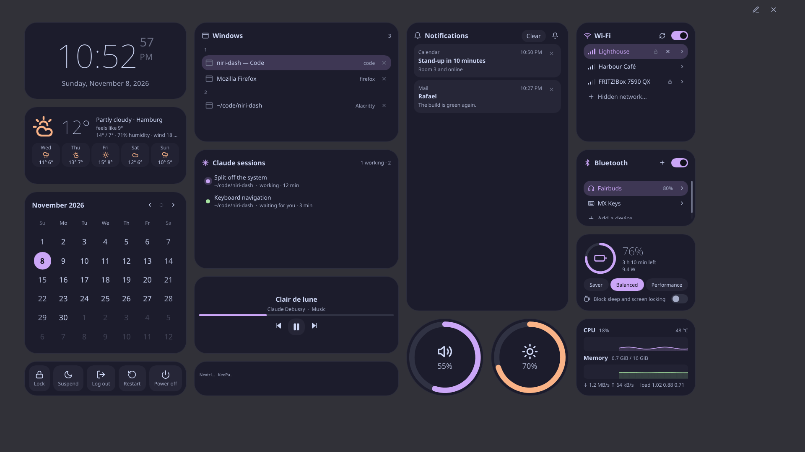
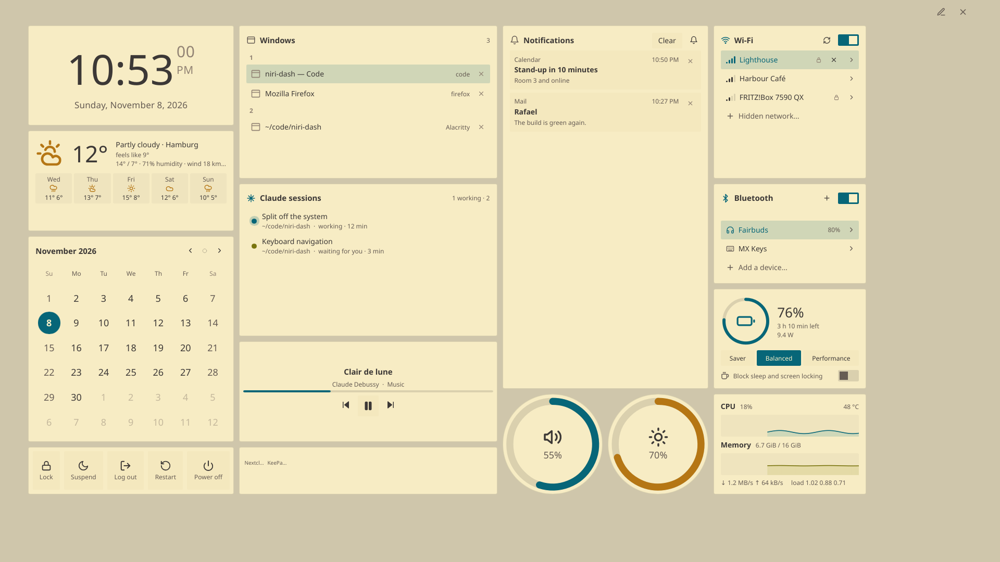
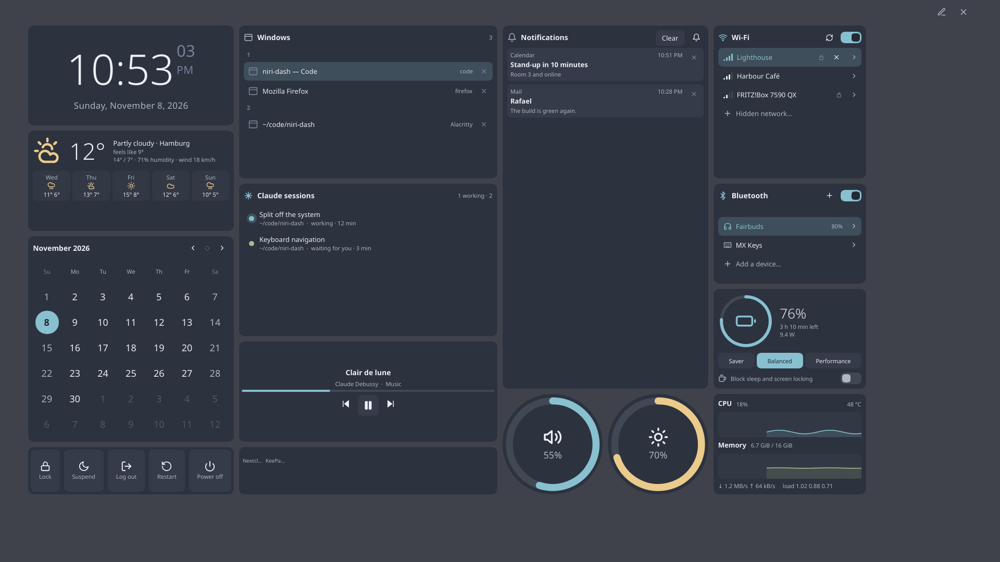
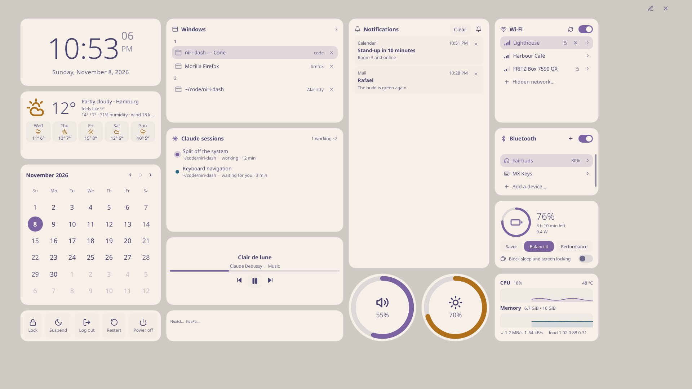

# niri-dash

A fullscreen widget dashboard for the [niri](https://github.com/YaLTeR/niri) Wayland compositor
and for KDE Plasma 6. One key brings it up over everything; another press, Escape or a click on the
background puts it away.


**[Try it in your browser](https://barafael.github.io/niri-dash/)** · **[Read the manual](https://barafael.github.io/niri-dash/manual/)**

The browser version is the same dashboard, keyboard and all, on a simulated system whose machine,
network and notifications keep changing. (It is the [Slint variant](#the-slint-variant) of the
dashboard, the only one that builds for a browser.) The manual has a tutorial, how-to guides, and a
reference for every widget, key, setting and command.

## What it is

- **One overlay, on demand.** A single daemon draws a layer-shell overlay with
  [GPUI](https://gpui.rs) (Zed's UI framework), on the GPU through Vulkan or OpenGL. While it is
  hidden its window is closed, nothing renders and its data sources go quiet.
- **Widgets for the whole desktop:** time, windows, notifications, Wi-Fi, Bluetooth, volume, media,
  battery, system load, and more. Most come in a rectangular and a round shape, and any one can run
  on its own as a small app window: `niri-dash app clock`.
- **Keyboard first.** Everything works without a mouse.
- **Yours to arrange.** A Plasma-style edit mode: drag, resize, restyle, recolor. Your layout is a
  plain text file.

## Screenshots


*Edit mode: drag widgets, resize them from any edge, add more from the sidebar.*


*Pressing `f` labels every widget; typing a label goes into that widget.*

Color schemes and styles are separate, and mix freely:

| catppuccin-mocha, soft | gruvbox-light, sharp |
|---|---|
|  |  |
| **nord, compact** | **rose-pine-dawn, default** |
|  |  |

## What it shows

| | |
|---|---|
| **Time** | Clock, calendar, weather (Open-Meteo, no API key), timer, stopwatch, pomodoro, sleep timer |
| **Activity** | Windows by workspace, notifications, clipboard history, sticky notes, Claude Code sessions and usage, a mascot that comments on your day, an About card |
| **Media** | Now playing (MPRIS) |
| **System** | CPU, memory, disks, network and GPU, battery and power profiles (with a switch that blocks sleep and screen locking), privacy (who uses the microphone, camera or screen) |
| **Devices** | Wi-Fi, Bluetooth, removable drives, phone (KDE Connect) |
| **Controls** | Volume, brightness, night light, system tray, session (lock, suspend, log out, …), keyboard layout, color picker |

Every widget, with its sizes and settings, is in the [widget reference](https://barafael.github.io/niri-dash/manual/reference/widgets/index.html).

### What it reads

- **Clipboard history is opt-in.** niri-dash reads what you copy only while a clipboard widget is in
  your layout or `niri-dash app clipboard` is running. The history stays in memory and skips what
  password managers mark secret.
- **The Claude usage widget reads only local files:** session transcripts in `~/.claude/projects`
  for the token counts, and two plan fields of `~/.claude.json`. It never opens the file with your
  login tokens.
- **The weather widget is the only one that makes network requests of its own** (to Open-Meteo).

### From the keyboard

`f` labels every widget with the start of its name, and typing a label goes into that widget;
`j`/`k`/`h`/`l` move inside it, `e` blows it up, `s` opens its settings, and Escape steps back.
Ctrl+M moves the widget and Ctrl+R resizes it (`h`/`j`/`k`/`l` act on it until Escape; in resize
mode Shift pulls a side in). Ctrl+E opens edit mode. The tips along the bottom of the screen
always list the keys that work just now. Lists have letters of their own: `d` closes a window or dismisses a
notification, `r` rescans Wi-Fi, `t` turns it on and off, `m` mutes, `1`–`0` set a slider to
10–100 %, `x` ejects a drive, and so on. The calendar has a day cursor: `h`/`l` a day, `j`/`k` a
week, `n`/`p` a month, `t` back to today, `Ctrl+C` copies the day as `YYYY-MM-DD`.

### Edit mode

The pencil in the corner (or a right-click on the background) opens edit mode. Its sidebar also sets
the grid, the color scheme (gruvbox, catppuccin, nord, dracula, rose-pine, …) and the style: corners,
spacing, fonts, animation speed, frosted glass. Its Arrange tab lays the widgets out by itself
(experimental: its settings may change between releases).

## Where it runs

| | Tested with | Notes |
|---|---|---|
| niri | 26.04 | Built against `niri-ipc` 26.4. Other releases may work; the IPC is only versioned with niri itself. |
| KDE Plasma | 6.8 | Plasma 6 only. [Some widgets don't work there.](#on-kde-plasma) |
| Rust | stable | 1.95 or newer (the `kdl` crate needs it). CI builds with the latest stable and with 1.95. |
| GPU | Vulkan or OpenGL | What GPUI's renderer (wgpu) draws with; a software Vulkan driver such as lavapipe works too. |
| Browser | any with WebGL 2 | For the web version (the Slint variant) only. |

## Where to get it

Needs a Rust toolchain, the development files of Wayland, xkbcommon, fontconfig and FreeType, and a
Vulkan (or OpenGL) driver at run time.

```sh
cargo install --path . --locked
```

### On niri

```kdl
spawn-at-startup "niri-dash"

binds {
    Mod+N { spawn "niri-dash" "toggle"; }
}
```

### On KDE Plasma

Start `niri-dash` at login (System Settings → Autostart), and bind a key to `niri-dash toggle`
(System Settings → Keyboard → Shortcuts → Add New → Command or Script). Run
`niri-dash desktop-entries` once for the window list.

Plasma keeps showing notifications; the notification widget pauses its pop-ups, and the history
there is a copy of what Plasma was sent since niri-dash started. Night light, keyboard layouts, the
color picker, logging out and going to a Claude session's window go through Plasma; a session in
Konsole gets its tab brought up too. Noticing screen sharing needs niri. The manual lists
[what else differs](https://barafael.github.io/niri-dash/manual/reference/plasma.html).

`niri-dash --help` lists the other commands: `inhibit`, `dnd`, `night-light`, `say`, ….

## Where it keeps things

| What | Where |
|---|---|
| Layout and settings | `~/.config/niri-dash/config.kdl`, which edit mode writes back with your comments intact |
| Color schemes and styles | `colorschemes/` and `styles/` next to it, as KDL files; add your own |
| Saved state | `niri-dash/state.json` in `$XDG_STATE_HOME` (usually `~/.local/state`) |

`~/.config` is `$XDG_CONFIG_HOME` where that is set. The manual lists
[every file and environment variable](https://barafael.github.io/niri-dash/manual/reference/environment.html).

## Where to read more

- The [manual](https://barafael.github.io/niri-dash/manual/): start with the tutorial.
- The [web version](https://barafael.github.io/niri-dash/): try it without installing.
- [SECURITY.md](SECURITY.md): what niri-dash touches, and how to report a problem.

## Developing

The dashboard is the root crate; [`PORTING.md`](PORTING.md) is its architecture (how the state, the
views, the widgets and the keyboard fit together, and the rules new code follows).

```sh
cargo run                                   # the daemon, on the real system
NIRI_DASH_MOCK=1 cargo run                  # ... on made-up data (never on the session you work in)
cargo check --all-targets --features testing
cargo test --features testing               # everything that needs no real system
cargo clippy --all-targets --features testing
cargo fmt --all
```

The `testing` feature is the headless harness (`src/testing.rs`): the dashboard in a window of
GPUI's test platform, driven with keys and clicks and checked against the mock system, with no
compositor and no GPU. The tests in `tests/` are plain programs on it, and `niri-dash stress`
(built with the feature) presses random keys at it. The tests that run system code, the screen reader
ones among them, only run in the [test box](testbox/README.md) (`cargo testbox test`).

Pictures, for the manual and for looking at changes:

```sh
cargo build --features testing
target/debug/niri-dash snapshot --mock --edit out.png   # the dashboard drawn headlessly to a PNG
book/screenshots.sh target/debug/niri-dash              # all of the manual's pictures
scripts/vshot.sh target/debug/niri-dash out show        # the real binary on a private virtual KWin
```

`snapshot` draws with GPUI's own renderer onto a texture: it needs a GPU (or lavapipe), not a
display. `scripts/vshot.sh` runs a binary in its own virtual compositor and takes screenshots of
the screen, which is the closest to what you see; it never touches your session.

The manual is an [mdBook](https://rust-lang.github.io/mdBook/) in `book/`: `mdbook serve book`. Its
widget tables are written from the source by a test (`cargo test --features testing --lib book`; see
`src/book.rs`), and its screenshots by `book/screenshots.sh`.

A push to `main` runs the tests of both variants (`.github/workflows/`) and puts the manual and
the web version (built from `slint/`) on GitHub Pages.

### The Slint variant

`slint/` holds the dashboard as it was written on [Slint](https://slint.dev), before the GPUI
rewrite: the same widgets, the same system crate (`crates/system`), another toolkit. It is kept for
comparison (and because only it builds for a browser). It is a workspace of its own, so build it
from its directory (the first build takes a while: it has its own `target/`):

```sh
cd slint
cargo run                                   # niri-dash-slint, the daemon
NIRI_DASH_MOCK=1 cargo run -- daemon --show
cargo test                                  # its tests
trunk serve                                 # the web version (rustup target add wasm32-unknown-unknown; cargo install trunk)
```

Both programs read the same `config.kdl`, so point one at a scratch copy to compare them
(`NIRI_DASH_HOME=/tmp/h`, with `config/niri-dash/config.kdl` below it), and run each on a virtual
screen with `scripts/vshot.sh` to put the pictures side by side. `slint/` shares nothing but
`crates/system` and the manual's text with the GPUI crate: `PORTING.md` lists what differs.

## License

MIT or Apache-2.0, at your option.

The dashboard is built on [GPUI](https://gpui.rs) and its component library, which are
Apache-2.0 (and a few of their dependencies carry other permissive licenses).

The Slint variant in `slint/` is built with [Slint](https://slint.dev), used under its
[Royalty-free Desktop, Mobile, and Web Applications
License](https://github.com/slint-ui/slint/blob/master/LICENSES/LicenseRef-Slint-Royalty-free-2.0.md).
That license asks for attribution, which is the "Made with Slint" badge on the [web
version](https://barafael.github.io/niri-dash/) and the About widget of that variant. If you
redistribute the Slint variant or a fork of it, keep a badge on a public page where it can be found,
or add Slint's `AboutSlint` widget to an About screen; or use Slint under the GPL-3.0 instead. The GPUI
crate has none of this: it contains no Slint code.

`slint/patches/i-slint-renderer-software` is a lightly patched copy of Slint's software renderer
(see its README) and keeps Slint's own licenses, in its `LICENSES` directory.
