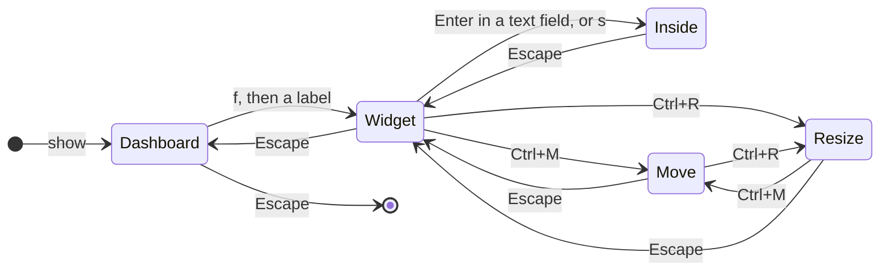

# The keyboard model

niri-dash is made to be used without the mouse, and its keys follow one idea: you are always at
one *level*, the keys mean what the level says, and Escape goes up one.

## Three levels

| Level | You are | Keys are about |
|---|---|---|
| The dashboard | Looking at all the widgets. | Choosing a widget. |
| A widget | Inside one widget. | Moving within it and acting on it. |
| A text field, a card, a menu | Inside something in a widget. | Typing, or choosing. |

Escape leaves a level. On the dashboard itself, Escape puts the dashboard away. That is why the
same key gets you out of a text field, out of a widget and out of the dashboard, one press each.

## Choosing a widget by typing its name

With dozens of widgets, arrow keys across a grid are slow, and the grid changes whenever you
rearrange it. So the dashboard doesn't navigate by position. `f` puts a label on every widget, and
you type the label.

A label is the start of the widget's name, as short as the other widgets on the dashboard allow:
`v` is volume, and `ca` is the calendar. Which letters are enough depends on what else is there: a
calendar next to a clock and a clipboard still gets `ca`, while those two become `clo` and `cli`.
If one widget's whole name starts another's, a number sets it apart. Two-word names go by the first
word's initial: `cs` for claude-sessions, `sm` for system-monitor.

Three properties follow from that rule:

- A label doesn't depend on where the widget is, so you can learn it once and move widgets around.
- Labels get longer only when you add widgets with similar names, and then only for those.
- No label is the start of another, so a label never needs a confirming key: the last letter
  that makes it unique goes into the widget.

The labels come from the widget's name in `config.kdl`, not its title. That is the reason for the
two-word rule: the name is `claude-sessions`, and the key is `cs`.

## Edit mode: two places for the keys

Edit mode has the same idea with two places the keys can be: the widgets and the sidebar. The same
letters mean something in each. `h`, `j`, `k` and `l` pick the neighbouring widget when the keys
are on the widgets, and move between rows and step values when they are in the sidebar. Tab goes
from one to the other, and `w`, `a`, `s` and `d` go back. The quick tips along the bottom of the
screen always list the keys that work in the place you are, so you don't have to remember which
it is.

## Modes: moving and resizing

Moving and resizing a widget are modes, entered with Ctrl+`m` and Ctrl+`r`. A mode takes
`h`, `j`, `k`, `l` (or the arrows) away from whatever they meant, so they can act on the widget as
a whole: in move mode they push it a cell, in resize mode they pull the side they point to
outwards, and with Shift inwards. Ctrl is what keeps the modes out of a widget's way: inside a
widget every plain letter is the widget's own (`m` mutes the volume, `r` restarts the
Pomodoro), but no widget uses Ctrl+`m` or Ctrl+`r`.

A mode is also a level, and Escape leaves it first. While one lasts the keyboard belongs to the
mode, which is why other keys do nothing: there is no way to press `d` and close a window by
mistake while arranging.

The state of the keys has to be visible, since a mode you can't see is a trap. Two places show it:
the quick tips along the bottom of the screen list the keys that work right now in every state
(from the idle dashboard to a mode), and the widget in hand wears a slightly transparent veil
with the mode's name, its keys and its size.

## Moving between widgets without going out

Ctrl+`h`/`j`/`k`/`l` goes to the neighbouring widget, in the direction you press. This is the one
place where position matters, and it does so only between widgets that are already next to one
another.

## Inside a widget

Inside, the keys are the same four everywhere (`h`, `j`, `k`, `l`, with Tab, Enter and Space), and
what they mean follows what the widget is: down a list, along a slider, across a calendar. A
widget adds letters for its own actions (`d` to close a window, `t` to switch a radio, `x` to
eject a drive).

Reference: [Keyboard](../reference/keyboard.md).
