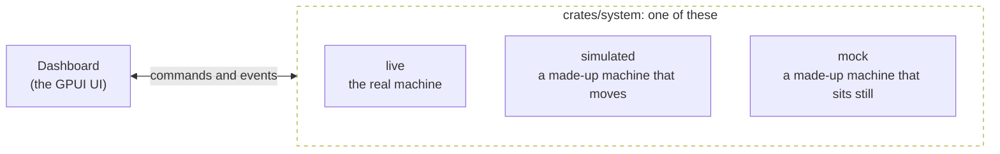

# The simulated system

niri-dash has three systems to run on, and the dashboard can't tell which it has.

| System | What it is | Used by |
|---|---|---|
| Live | The real machine: D-Bus services, the compositor, files and sockets. | The daemon and the apps. |
| Simulated | A made-up machine that keeps moving. | The web version (the Slint variant), and the desktop with `NIRI_DASH_SIM=1`. |
| Mock | A made-up machine that sits still. | The UI tests, `niri-dash snapshot --mock`, `niri-dash stress` and the manual's screenshots. |

## One boundary

The dashboard doesn't call the system. It holds the senders of a set of actors (one per part of the
machine: audio, Wi-Fi, power, notifications, …), sends them commands and receives their events on
its event loop. The actors live in their own crate, `crates/system`, and the dashboard knows only
the commands and events.

Any set of actors that speaks the same commands and events can stand in for the real ones. That is
the whole mechanism, and the simulated and mock systems are two such sets.

## Why a browser needs one

A page has no D-Bus and no compositor to ask. For the web version to be the same dashboard and
not a picture of it, something has to answer the questions the dashboard asks. The simulated
system does: it has a machine that builds and browses and takes calls, batteries that run down,
notifications that arrive and networks that drift in and out of range.

It isn't a replay. What nobody can change is a function of the clock, each thing on a period of its
own. What you change through the dashboard (a slider, a pairing, a password) works and stays done,
as it would on a real machine.

The web version keeps the layout and settings in the browser's localStorage, and `?reset` starts
over. On the desktop, `NIRI_DASH_SIM=1` runs either variant on the same simulation, which is a way
to try niri-dash without anything on your machine being read or changed.

## Why the mock sits still

Screenshots and tests need the same answer every time. The mock reports a fixed, believable state
for every part of the machine, and answers commands the way the real one would where the dashboard
depends on it: a slider moves, a device connects, a picked color comes back.

The clock isn't part of that. It is the real one, which is why the manual's screenshots differ in
the time they show every time they are made.

## Where each is chosen

| To get | Do |
|---|---|
| The simulated system on the desktop | Set `NIRI_DASH_SIM`. |
| The mock system | Set `NIRI_DASH_MOCK`, or pass `--mock` to `niri-dash snapshot`. |
| A UI test | Drive the dashboard through channels that stand in for the system (`src/testing.rs`: GPUI's test platform, no compositor and no GPU). |

Reference: [Environment variables](../reference/environment.md),
[Command line](../reference/command-line.md).
