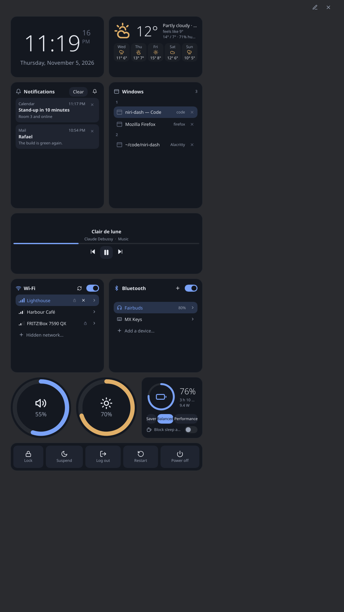

# How to use a portrait layout

The repository has a layout for a screen taller than wide: fewer widgets, stacked. The web
version uses it by itself when the page is taller than wide. On the desktop, `config.kdl` starts
from the landscape layout, so you copy this one in.



1. Open `~/.config/niri-dash/config.kdl`.
2. Replace its `layout { … }` block with the one from `assets/config-portrait.kdl`, shown whole
   here (its `theme` line you can leave out):

   ```kdl
   {{#include ../../../assets/config-portrait.kdl}}
   ```

3. Save. Widgets you edit by hand are picked up while the dashboard runs.
