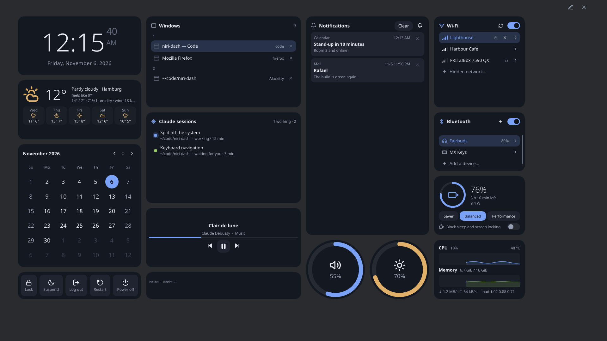

# niri-dash

niri-dash is a fullscreen widget dashboard for the [niri](https://github.com/YaLTeR/niri)
Wayland compositor and for KDE Plasma 6. One key brings it up over everything; another press of
the key, Escape, or a click on the background puts it away.

It runs as a single daemon. The dashboard is a layer-shell overlay drawn with
[Slint](https://slint.dev), on the GPU through EGL or in software. While it is hidden it renders
nothing and its data sources go quiet.

*The default layout, on made-up data (`niri-dash snapshot --mock`).*

## Requirements

| | |
|---|---|
| Compositor | niri, or KDE Plasma 6. Some widgets don't work on Plasma: see [KDE Plasma](reference/plasma.md). |
| Building | A stable Rust toolchain, and the Wayland, EGL, fontconfig and xkbcommon libraries. |
| Without installing | The [web version](https://barafael.github.io/niri-dash/) runs the same dashboard on a simulated machine. |

## How this manual is organised

| If you want to | Read | It contains |
|---|---|---|
| Learn by doing | [Tutorials](tutorials/first-dashboard.md) | Two guided sessions, in the browser, with nothing to break. |
| Get something done | [How-to guides](how-to/index.md) | Short procedures: install, start at login, change a setting. |
| Look something up | [Reference](reference/index.md) | Every widget, key, setting and command, described and nothing else. |
| Understand why | [Explanation](explanation/index.md) | How and why the dashboard behaves as it does. |

The manual describes the version in this repository. Where a page says a setting has a default,
that is the default of the source it was built from.
