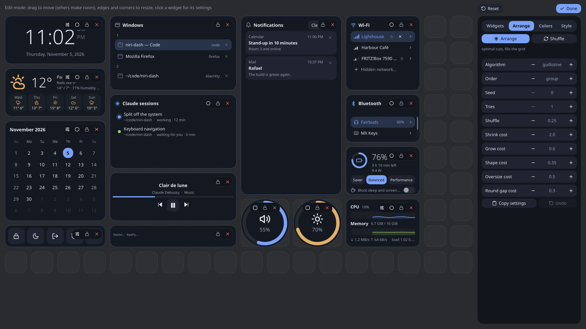

# config.kdl

The configuration file is [KDL](https://kdl.dev). It is the source of truth for the layout and
the look: edit mode writes changes back into it in place, so your comments and formatting
survive, and widgets you edit by hand are picked up while the dashboard runs.

Where it is: `~/.config/niri-dash/config.kdl`. See
[Environment variables and files](environment.md) for what moves it.

The shipped file (`assets/config.kdl`), shortened:

```kdl
theme colorscheme="default" style="default"

// Read, and ignored: GPUI always draws with its GPU renderer (the Slint variant used it).
// renderer "auto"

// weather location="Hamburg"
// weather latitude=53.55 longitude=9.99 units="fahrenheit"

layout {
    clock           col=0  row=0 width=4 height=2
    weather         col=0  row=2 width=4 height=2
    calendar        col=0  row=4 width=4 height=4
    session         col=0  row=8 width=4 height=1
    // … one line per widget
}
```

## Nodes

| Node | Arguments and properties | Meaning |
|---|---|---|
| [`theme`](#theme) | `colorscheme`, `style` | Which color scheme and style to use. |
| [`grid`](#grid) | `columns`, `rows` | A fixed grid size. |
| [`weather`](#weather) | `location`, `latitude`, `longitude`, `units` | Where the weather is for. |
| [`renderer`](#renderer) | one argument | Accepted for old files; GPUI ignores it. |
| [`autolayout`](#autolayout) | `algo`, `order`, `placement`, `seed`, `restarts`, and numeric knobs | Starting point for Arrange. |
| [`layout`](#layout) | children: one node per widget | The widgets and where they are. |

## theme

```kdl
theme colorscheme="gruvbox-dark" style="soft"
```

| Property | Type | Default |
|---|---|---|
| `colorscheme` | string, the name of a file in `colorschemes/` without `.kdl` | `"default"` |
| `style` | string, the name of a file in `styles/` without `.kdl` | `"default"` |

The node can also have children, one `name value` per line, that override single values of the
chosen scheme and style.

## grid

```kdl
grid columns=18 rows=10
```

| Property | Range |
|---|---|
| `columns` | 4 to 48 |
| `rows` | 3 to 32 |

Values outside the range are clamped. Without a `grid` node, the grid is the size that fits the
screen; the sidebar in edit mode shows "fits the screen".

## weather

```kdl
weather location="Hamburg"
weather latitude=53.55 longitude=9.99 units="fahrenheit"
```

| Property | Meaning |
|---|---|
| `location` | A place name. Without any location, the city of your time zone. |
| `latitude`, `longitude` | Coordinates. |
| `units` | `"fahrenheit"` for Fahrenheit. |

## renderer

```kdl
renderer "software"
```

The dashboard draws with GPUI's renderer, which is always the GPU's (through wgpu, on Vulkan or
OpenGL); there is nothing to choose. The line is still read, so that a `config.kdl` written for
the Slint variant, which chose between `"auto"`, `"gpu"` and `"software"` here, loads without a
warning. Any other value is warned about. See [Renderers](../explanation/renderers.md).

## autolayout

> [!WARNING]
> **Experimental.** Arrange, its algorithms and the `autolayout` line in `config.kdl` may change
> or be removed in any release, before and after 1.0. A line you copied out of the Arrange tab
> may need changing after an update; settings niri-dash no longer knows are reported as config
> warnings.

```kdl
autolayout algo="guillotine" order="group" seed=3 restarts=16 shrink=2.0 grow=0.6
```

The settings Arrange starts from. In edit mode, the **Copy settings** button in the Arrange tab
puts the current ones on the clipboard as such a line.

| Property | Values |
|---|---|
| `algo` | `"guillotine"`, `"treemap"`, `"gravity"`, `"neighbours"` |
| `order` | `"group"`, `"area"`, `"reading"`, `"kind"`, `"affinity"` |
| `placement` | `"off"`, `"edges"`, `"center"` |
| `seed` | a number from 0 to 999 |
| `restarts` | a number from 1 to 64 |

The other keys take numbers. Each is one row of the Arrange tab: Each is one row of the Arrange tab:

| Key | Row in the Arrange tab | Only for |
|---|---|---|
| `jitter` | Shuffle | — |
| `shrink` | Shrink cost | — |
| `grow` | Grow cost | — |
| `aspect` | Shape cost | — |
| `overshoot` | Oversize cost | — |
| `hole` | Round gap cost | — |
| `max-grow` | Max growth | `gravity` |
| `weight-exponent` | Area weight | `treemap` |
| `cut-bias` | Cut bias | `treemap` |
| `affinity` | Neighbour pull | `neighbours` |
| `reach` | Neighbour reach | `neighbours` |
| `edge` | Lean strength | `neighbours` |
| `balance` | Centering | `neighbours` |
| `effort` | Effort | `neighbours` |

A number outside a row's range is clamped. What each one weighs is in
[How Arrange chooses a layout](../explanation/arrange.md).

A key that isn't known, or a value that doesn't fit, is warned about and ignored.



## layout

One child node per widget. The node's name is the widget's name, as in the
[widget index](widgets/index.md).

```kdl
layout {
    clock col=0 row=0 width=4 height=2 {
        hours 12
        seconds #false
    }
    volume col=9 row=7 size=2 shape="round"
    wifi col=13 row=0 width=3 height=3 pinned=#true
}
```

| Property | Meaning |
|---|---|
| `col`, `row` | The top left cell, counting from 0. |
| `width`, `height` | Size in cells. Without them, the widget's default size. |
| `size` | One number for both `width` and `height` (for round widgets). |
| `shape` | `"rect"` or `"round"`. A widget that can't be round is warned about and made rectangular. Without a shape, the widget's own default. |
| `pinned` | `#true` keeps the widget where it is: nothing pushes it aside and Arrange lays the others out around it. |

Children of a widget's node are its [settings](widgets/index.md). An unknown widget name, or a
setting the widget doesn't have, is warned about.
