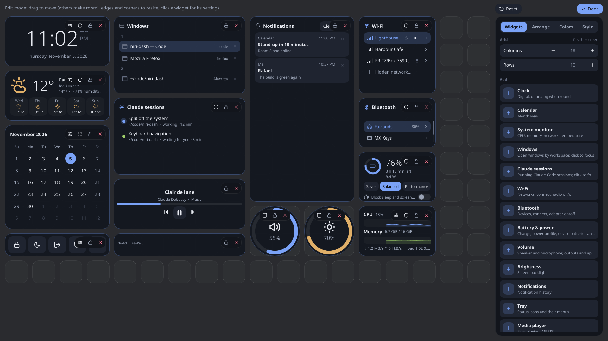

# Keyboard

niri-dash is built to be used from the keyboard. Keys fall into three levels: the dashboard,
inside a widget, and edit mode. Escape always steps back one level.

## On the dashboard

| Key | Does |
|---|---|
| `f` | Labels every widget with the start of its name, as much as it takes to tell it from the others: `v` volume, `ca` calendar, `cl` clock, `n` notifications, `cs` claude-sessions. Two-word names go by the first word's initial. |
| *a label* | Goes into that widget. |
| Backspace | Takes back what you typed of a label. |
| Ctrl+`h` `j` `k` `l` (or Ctrl+`H` `J` `K` `L`) | Goes to the neighbouring widget. |
| Ctrl+E | Opens and closes edit mode. |
| Escape | Leaves the widget. A second Escape closes the dashboard. |

A standalone app (`niri-dash app <widget>`) starts inside its widget.

## Inside a widget

| Key | Does |
|---|---|
| `j` `k` | Moves between rows and buttons. Turns a knob or a lone slider down and up. |
| `h` `l` | Moves sideways, or changes a slider. |
| Tab, Shift+Tab | Steps through the stops. |
| Enter, Space | Presses. |
| `g` `G` | Jumps to the first or last item. |
| `e` | Blows the widget up in the middle of the dashboard (round widgets open into their full form). `e` or Escape puts it back. |
| `s` | Opens the widget's settings, the same card as in edit mode. |
| Ctrl+Shift+`h` `j` `k` `l` | Moves the widget one cell, pushing the others aside. |
| Ctrl+`r` | Sizes the widget (see below). |
| Enter on a text field | Types into it. Escape gets you out again. |

Lists have letters of their own:

| Key | Does |
|---|---|
| `d` | Closes a window, or dismisses a notification. |
| `r` | Rescans Wi-Fi. |
| `t` | Turns the thing on and off. |
| `m` | Mutes. |
| `1` … `9`, `0` | Sets a slider to 10 … 90 %, and 100 %. |
| `x` | Ejects a drive. |

### Sizing a widget

Ctrl+`r` starts sizing. Then:

| Key | Does |
|---|---|
| `H` `J` `K` `L` | Pushes that side out one cell. |
| `h` `j` `k` `l` | Pulls that side in one cell. |
| Enter, Escape or Ctrl+`r` | Finishes. |

A pinned widget (`p` in edit mode, or the lock in its toolbar) can't be moved or resized until you unpin it.

### Calendar

| Key | Does |
|---|---|
| `h` `l` | A day back, forward. |
| `j` `k` | A week forward, back. |
| `n` `p` | A month forward, back. |
| `t` | Back to today. |

### Volume

| Key | Does |
|---|---|
| `j` `k` | Makes the slider under the cursor quieter and louder. |
| Tab | Goes to the next slider. |

### Sleep timer

| Key | Does |
|---|---|
| Enter or `i` | Types in the *when* field. Enter there arms the timer. |
| `j` `k`, arrows | Pick the mode. |
| Enter | Arms. |
| Space, `p` | Pauses and resumes. |
| `+` `-` | Moves the deadline a minute. |
| `d`, Ctrl+D | The dry run: counts down for real, then only says what would have run. |
| `a` | Keeps the screen on while it counts. |
| Escape | Gives up on the countdown before it leaves the widget. |

### Pomodoro

| Key | Does |
|---|---|
| Space | Starts and pauses. |
| `n` | Goes to the next part. A skipped focus session doesn't count. |
| `r` | Starts the part over. |

## In edit mode

| Key | Does |
|---|---|
| Ctrl+E | Opens and closes edit mode. |
| `f`, then a label | Picks a widget and opens its settings. |
| Ctrl+`h` `j` `k` `l` | Goes to the next widget. |
| Ctrl+Shift+`h` `j` `k` `l` | Moves the widget. |
| Ctrl+`r` | Sizes it: `H` `J` `K` `L` push a side out, `h` `j` `k` `l` pull it in. |
| `o` | Changes its shape. |
| `p` | Pins it. |
| `x` | Removes it. |
| Escape | Backs out one step at a time. |

In the sidebar and in a widget's settings card:

| Key | Does |
|---|---|
| Tab | In the sidebar, switches tabs. In the settings card, steps through the rows. |
| `j` `k` | Moves between rows. |
| `h` `l` | Steps a value, or flips a switch. |
| Enter, Space | Presses, or starts typing in a text field. |
| Backspace | Puts a row back to its default. |
