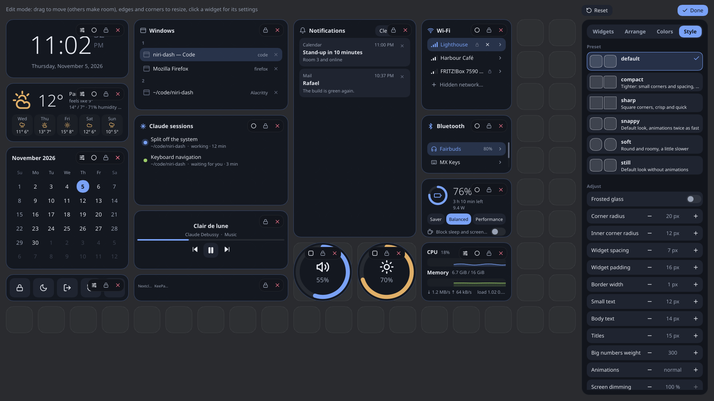

# Color scheme and style files

A theme is a **color scheme** paired with a **style**. Both are KDL files in
`~/.config/niri-dash/`, and any scheme goes with any style. `config.kdl` picks them with the
[`theme`](config.md#theme) node.

| | Color scheme | Style |
|---|---|---|
| Directory | `colorschemes/` | `styles/` |
| Holds | Colors only. | Everything but colors: corners, spacing, fonts, animation speed. |
| Top-level node | `colors { … }` | `style { … }` |
| Bundled | 21 | 6 |
| Name | The file name without `.kdl`. | The file name without `.kdl`. |

Anything a file leaves out keeps the default's value. The bundled files are written to the
configuration directory where they are missing.

## Description

The first line of a file is a comment that gives it the description shown in edit mode. Either
form works:

```kdl
// niri-dash color scheme: "nord" (Nord).
// niri-dash style: "soft". Round and roomy, a little slower.
```

A file without such a line is listed without a description.

## Color scheme

A color is `"#rrggbb"` or `"#rrggbbaa"` (alpha last); the short `"#rgb"` form is accepted too.

```kdl
colors {
    card   "#161a22f2"
    text   "#e6e9f0"
    accent "#7aa2f7"
}
```

| Color | Used for |
|---|---|
| `backdrop` | Dims the screen behind the dashboard. |
| `card` | Widget background. |
| `card-raised` | Buttons, and list cards inside widgets. |
| `panel` | The drawer, menus, toasts and edit toolbars. |
| `hover`, `pressed` | A control under the pointer, and one being pressed. |
| `border` | Borders. |
| `subtle` | Graph and grid backgrounds. |
| `shadow` | Shadows. |
| `text` | Text. |
| `dim` | Secondary text. |
| `faint` | Tertiary text and inactive icons. |
| `accent` | The accent color. |
| `accent-soft` | Selected rows and active buttons. |
| `on-accent` | Text on accent fills. |
| `good`, `warn`, `bad` | Good, warning and bad states. |
| `track` | Slider and ring tracks. |
| `knob` | Slider knobs. |

`default.kdl` in the directory shows every color with its value.

## Style

```kdl
style {
    radius 20
    gap 7
    motion 1.0
    glass #false
}
```

| Key | Default | Meaning |
|---|---|---|
| `radius` | `20` | Widget corner radius, in pixels. |
| `radius-small` | `12` | Corner radius of inner cards and list items. |
| `gap` | `7` | Half the space between widgets. |
| `padding` | `16` | Space inside widgets. |
| `border-width` | `1` | Border width. |
| `font-family` | `""` | Font family. Empty is the system default. |
| `font-small` | `12` | Small text size. |
| `font-body` | `14` | Body text size. |
| `font-title` | `15` | Title text size. |
| `font-weight-display` | `300` | Weight of big numbers (clock, battery). |
| `motion` | `1.0` | Animation speed: 1 normal, 0.5 twice as fast, 0 off. |
| `glass` | `#false` | Frosted glass: blurs what is behind the dashboard. |
| `backdrop-opacity` | `1.0` | How much the screen behind is dimmed, from 0 to 1. |
| `card-opacity` | `1.0` | How opaque widgets are, from 0 to 1. |

The bundled styles are `default`, `compact`, `sharp`, `snappy`, `soft` and `still`.



How-to: [How to write your own color scheme](../how-to/write-a-color-scheme.md).
