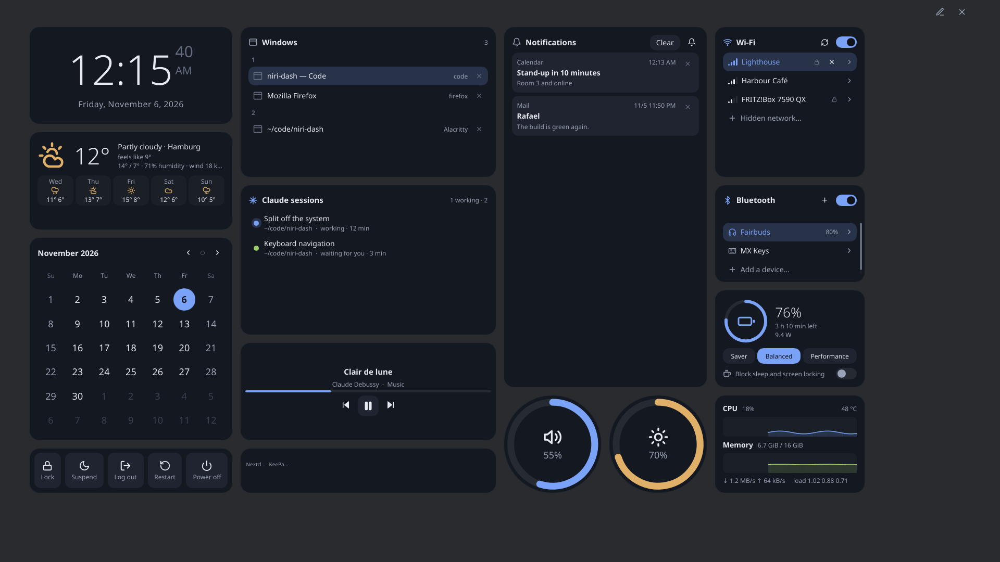
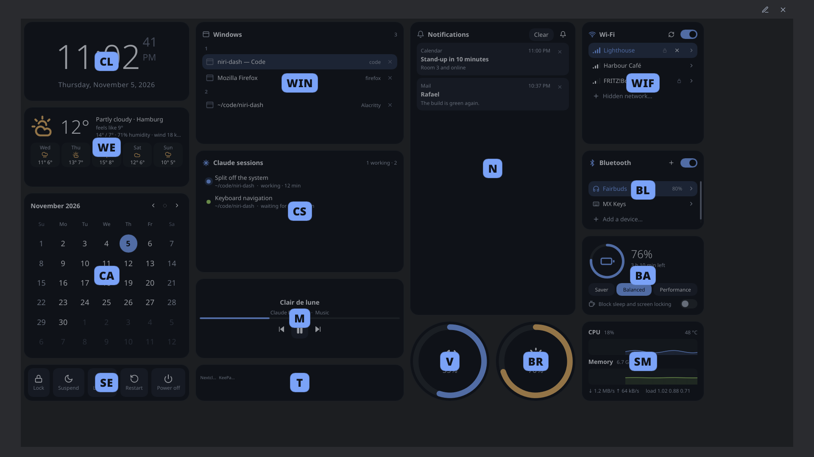
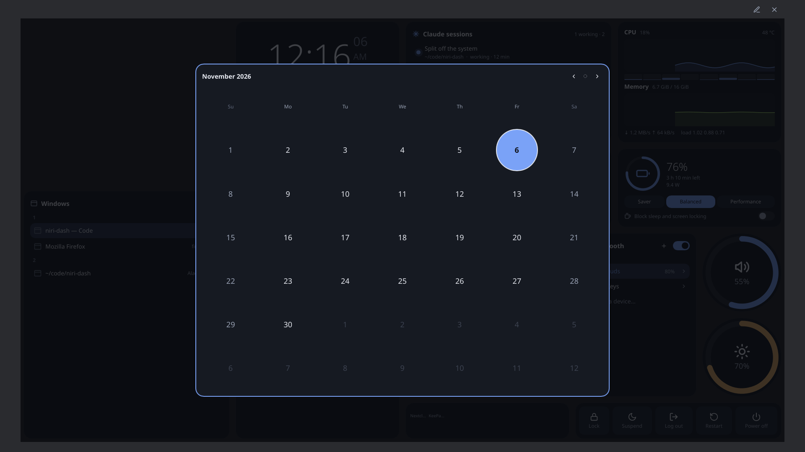
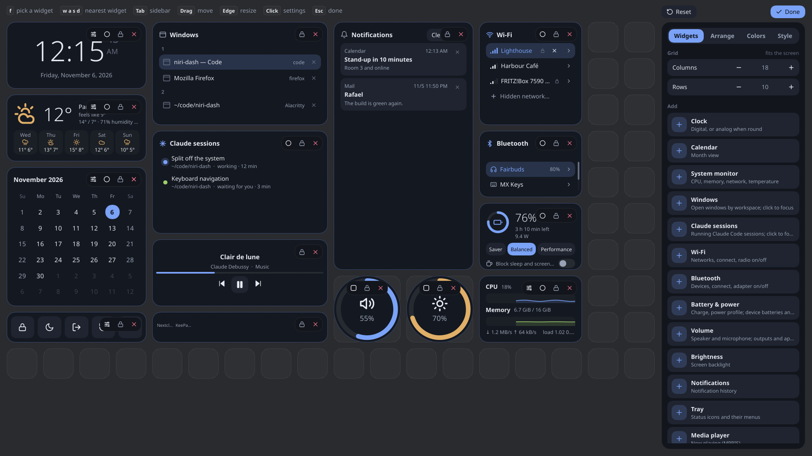
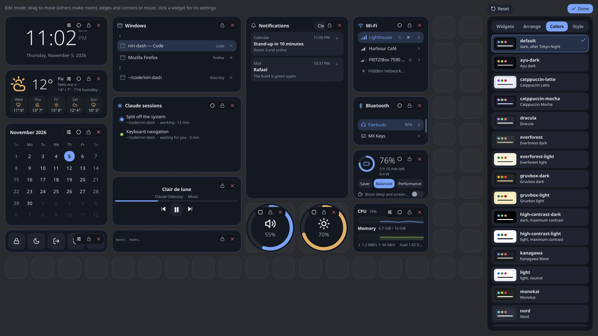
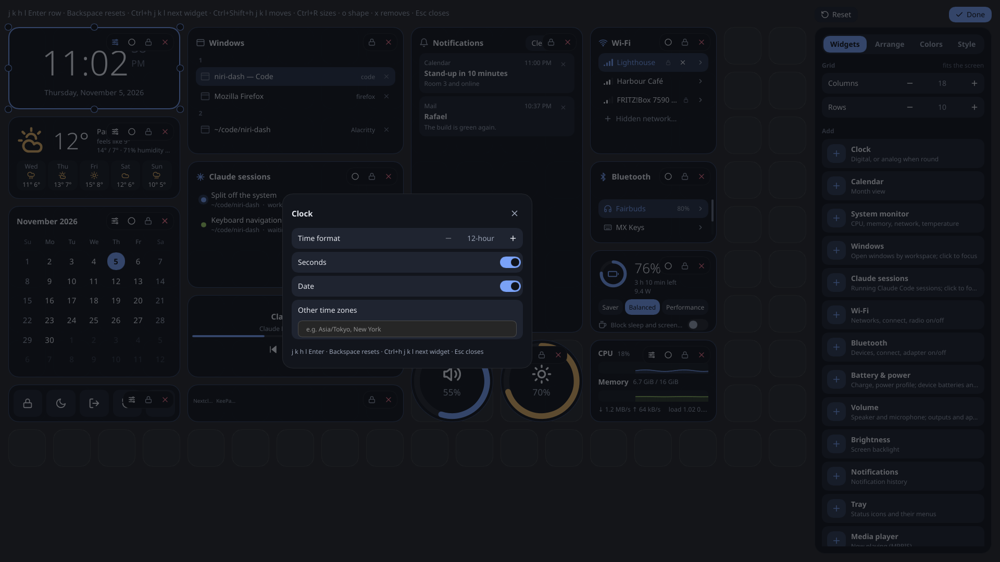

# Your first dashboard

In this tutorial you use the dashboard from the keyboard, then open edit mode and change what it
looks like. It all happens in the web version, on a simulated machine, so nothing on your own
system is read or changed.

## 1. Open the web version

Open <https://barafael.github.io/niri-dash/> in a browser.

You see the dashboard: a clock, the weather, a calendar, a list of windows, Wi-Fi, Bluetooth and
more, on a machine whose values keep changing.

## 2. Label the widgets

Press `f`.

Every widget gets a label: the start of its name, as much of it as it takes to tell it from the
others.

## 3. Go into the calendar

Type `ca`.

The calendar is now the widget you are working in. Press `n`: the calendar shows the next
month. Press `t`: it comes back to today.

## 4. Blow the calendar up

Press `e`.

The calendar opens in the middle of the dashboard, large.

Press `e` again. The calendar goes back to its place.

## 5. Leave the widget

Press Escape once. You are out of the calendar and back on the dashboard.

Don't press Escape again: a second Escape puts the dashboard away. (In the web version a key or a
click brings it back.)

## 6. Open edit mode

Click the pencil in the top right corner.

The widgets get small toolbars, empty cells show behind them, and a sidebar opens on the right
with four tabs: Widgets, Arrange, Colors and Style.

## 7. Change the colors

Click **Colors** in the sidebar, then click **nord** in the list.

The whole dashboard changes to the Nord colors. Click **default** to get the first ones back.

## 8. Change a widget's settings

Click the sliders button in the clock's toolbar.

A card opens in the middle of the screen with the clock's settings: *Time format*, *Seconds*,
*Date* and *Other time zones*.

Switch **Seconds** off. The small number beside the time is gone.

Press Escape to close the card.

## 9. Finish

Click **Done** in the top right corner.

The dashboard is back to normal, with the colors and the clock you set. Reload the page and they
are still there: the web version keeps them in the browser. To start over, add `?reset` to the
address and load it.

## Next

- [Reference: Keyboard](../reference/keyboard.md) lists every key.
- [How to change the color scheme or style](../how-to/change-theme.md) does step 7 in
  `config.kdl`.
- [How to install niri-dash from source](../how-to/install.md) puts the dashboard on your own
  machine.
