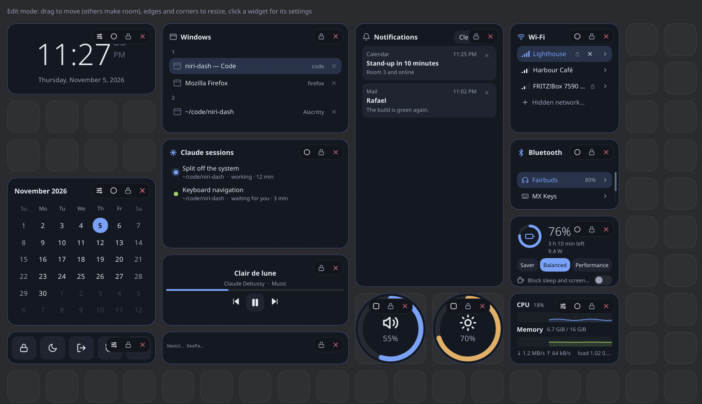
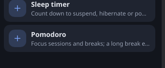
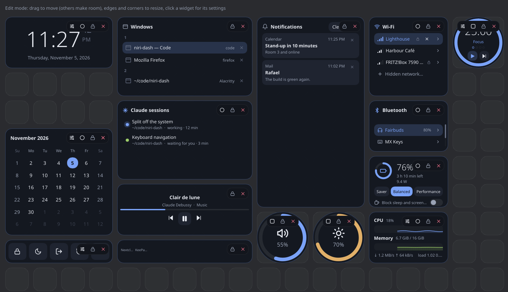
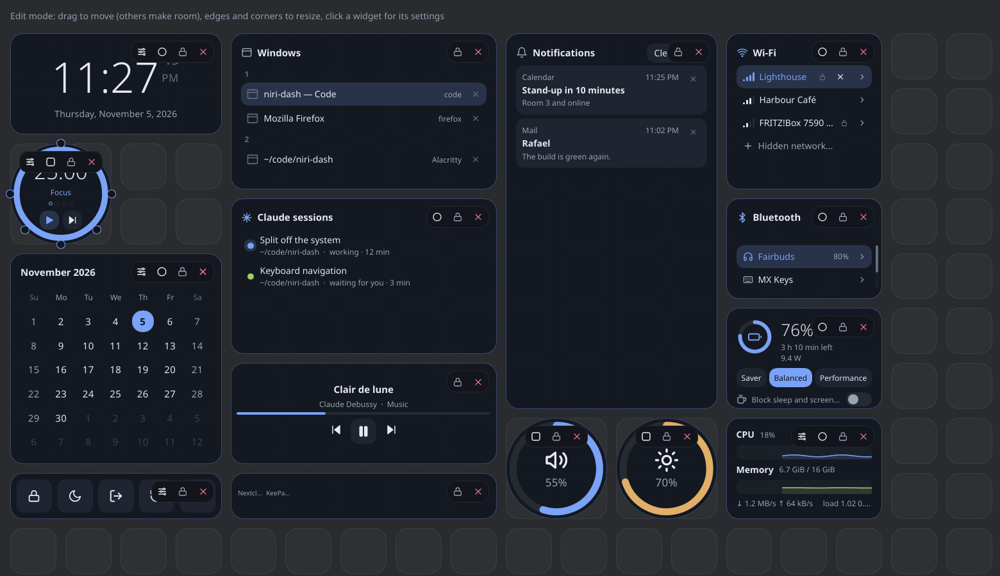
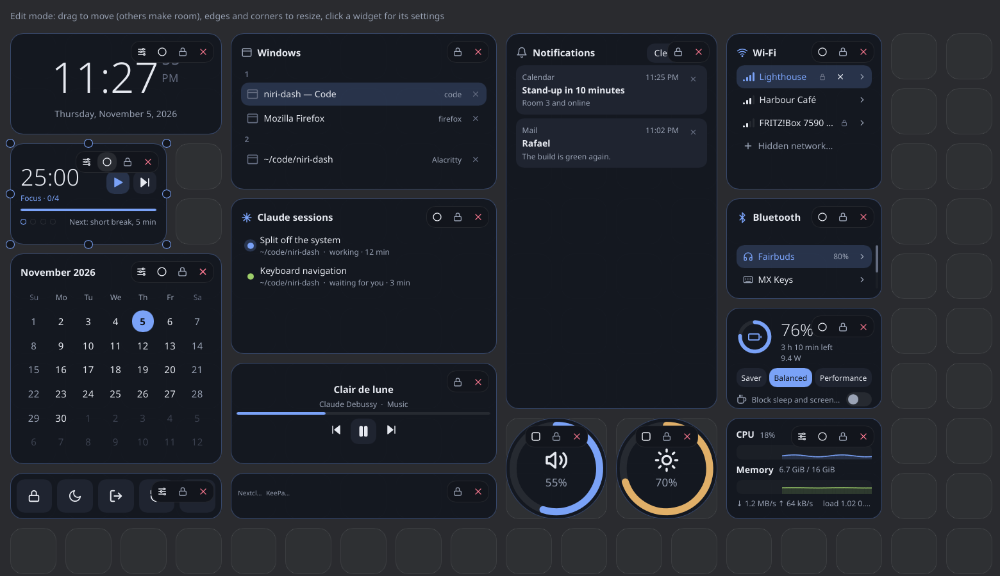
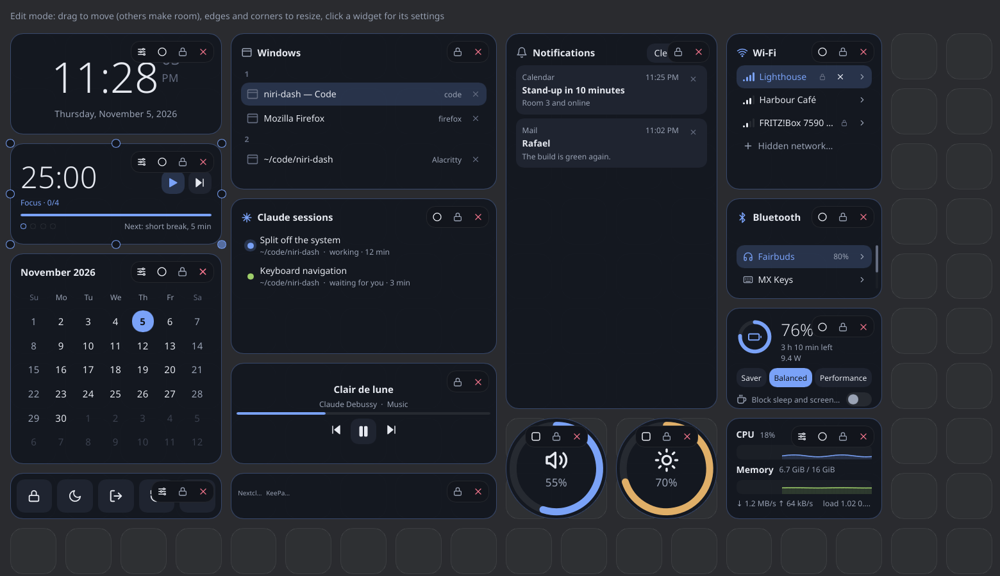
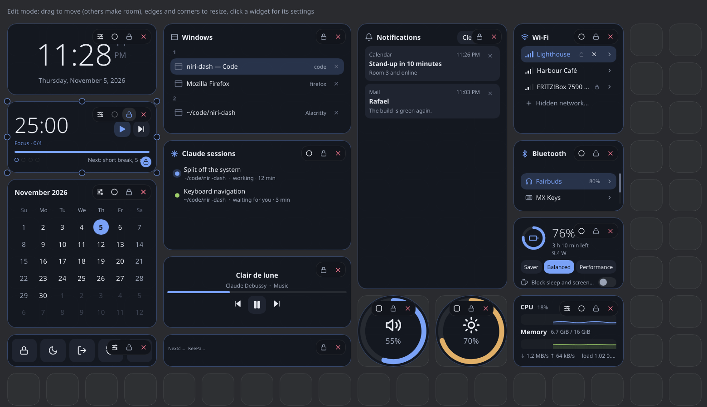

# Your own layout

In this tutorial you take the default layout and change it: you remove a widget, add another,
move it, resize it and pin it. It all happens in the web version, on a simulated machine, with the
mouse.

It assumes you have done [Your first dashboard](first-dashboard.md), or at least know how to open
edit mode.

## 1. Start from the default layout

Open <https://barafael.github.io/niri-dash/?reset>.

The `?reset` clears what the browser kept from earlier visits, so you start from the default
layout. Click the pencil in the top right corner to open edit mode.

## 2. Remove the weather

In the left column, under the clock, is the weather. Click the cross at the right end of its
toolbar.

The weather goes, and its place is empty.

## 3. Add a Pomodoro

In the sidebar, stay on the **Widgets** tab. Scroll the list under **Add** to the bottom, to
**Pomodoro**, and click the **+** next to it.

A message at the bottom of the screen says the widget was added. A round Pomodoro appears in a
free spot: a ring with a time of 25:00 in it, and a play button.

## 4. Move it into the gap

Press on the Pomodoro, anywhere but on its toolbar or its buttons, and drag it into the empty
cells under the clock. Let go.

## 5. Make it a rectangle

In the Pomodoro's toolbar, click the second button, the one with a square on it.

The ring becomes a bar, and the widget a rectangle with the time on the left.

## 6. Make it as wide as the clock

Small circles sit on the widget's edges and corners. Press on the one at the bottom right corner
and drag it to the right, until the widget is as wide as the clock above it. Let go.

## 7. Pin it

In the Pomodoro's toolbar, click the third button, the lock.

A small lock appears in the widget's bottom right corner, and the circles on its edges are gone.
A pinned widget can't be moved or resized, and nothing pushes it aside.

## 8. Finish

Click **Done** in the top right corner.

The dashboard is back to normal, with the layout you made. Reload the page and it is still there.
To start over, load the address with `?reset` again.

## Next

- [How to rearrange widgets automatically](../how-to/arrange.md) lays the other widgets out
  around the pinned one.
- [How to pin a widget](../how-to/pin-a-widget.md) and [Reference: Widgets](../reference/widgets/time.md#pomodoro)
  have the details of what you used.
- [How to install niri-dash from source](../how-to/install.md) puts the dashboard on your own
  machine.
