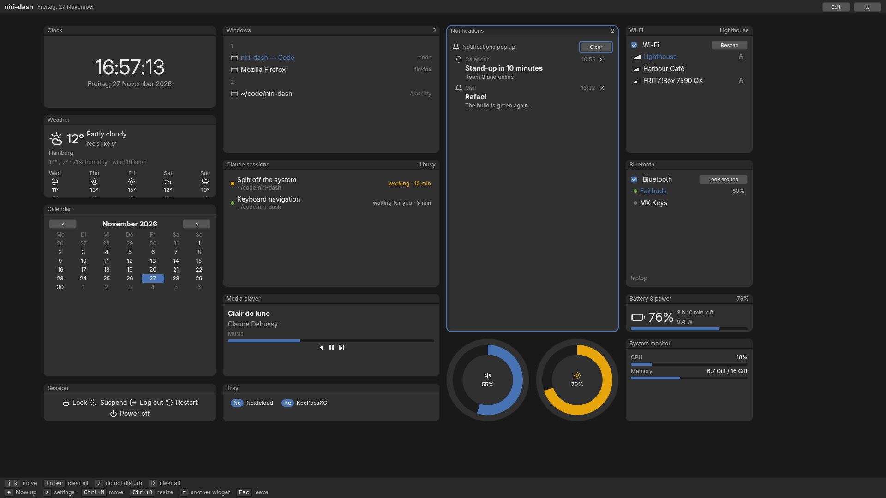
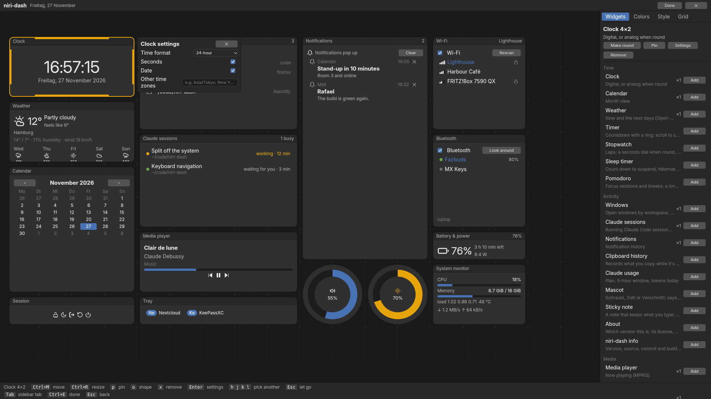

# niri-dash, drawn with BUI

An experiment: the dashboard remade with [BUI](https://bui.preetham.top/docs/rust/overview/)
(the `blenderui` crate, Blender's UI toolkit for Rust) instead of Slint. Visual resemblance was
not the goal; the behaviour is. It runs on the same system, reads and writes the same config file
and state, and takes the same commands and keys. It looks like Blender: every widget is a Blender
panel, and the sliders, buttons, checkboxes, dropdowns and text fields are Blender's own.





```sh
cargo run -p niri-dash-bui -- daemon --show       # the overlay (NIRI_DASH_MOCK=1: made-up data)
cargo run -p niri-dash-bui -- toggle              # show or hide it; starts the daemon if needed
cargo run -p niri-dash-bui -- app pomodoro        # one widget in a window of its own
cargo run -p niri-dash-bui -- snapshot --keys "f v" -o shot.png   # offscreen, on the mock system
cargo test -p niri-dash-bui
```

The binary is `niri-dash-bui`, and its control socket has a name of its own, so it runs beside
the Slint version. Every subcommand of that one is here too (`toggle`, `show`, `hide`, `edit`,
`quit`, `inhibit`, `dnd`, `app`, `say`, `night-light`, `snapshot`), except `desktop-entries`,
`window-rules` and `stress`. `scripts/vshot.sh` works with it unchanged.

## How it is put together

```
crates/system      the system, unchanged: this version sends its Commands and gets its Events
src/*.rs (links)   the root crate's files that don't touch the window, shared as they are:
                   layout (the config), autolayout, nav (hint labels, neighbours), timer,
                   pomodoro, mascots, cowfile, widget_settings, zones, state, files
bui/src/
  app.rs           the BUI application: the layer-shell window, the control socket, the
                   ticker, the config watcher, the system's events into the UI thread
  dash.rs          Dash, the state (a BUI entity that outlives the window), and the keys
  data.rs          what the system last reported
  view.rs          the backdrop, the cards on the grid, hint labels, quick tips, toast
  edit.rs          edit mode: drag, resize, pick, sidebar (widgets, colors, style, grid,
                   arrange), the settings card
  look.rs          color schemes and styles as CSS custom properties, and the stylesheet
  a11y.rs          screen readers: BUI's accessibility tree, served over AT-SPI
  widgets/         all 35 widgets, in groups, and their own state (timers, notes, mascots)
  testing.rs       the headless harness and the tests
  snapshot.rs      `snapshot`: the dashboard drawn offscreen into a PNG
```

The links in `bui/src` point at the root crate's files (and `bui/assets`, `bui/ui` at its icons,
color schemes and cows), so a fix there is a fix here.

**One function per widget, for the mouse and the keyboard.** A widget's `build` draws it and, as
it goes, registers its *stops* (what `j` `k` walk through, Enter presses, `h` `l` and the digits
adjust) and its *binds* (its own letters). The clickable elements are made by the same calls
(`c.button`, `c.press`, `c.slider`, `c.knob`, `c.field`), and the key handler runs `build` again
and acts on what it got. So nothing can be done with one that can't with the other, and the quick
tips list exactly the keys that work.

## What it does, next to the Slint version

The same: the overlay over everything (wlr-layer-shell, exclusive keyboard), toggled from the
command line; Escape and a click on the backdrop put it away; a right click opens edit mode. The
grid, cells and which widgets a screen hides are worked out as the Slint version does them. All 35
widgets, round and rectangular, on the same data, with the same commands. The keyboard: `f` and
the hint labels, Ctrl+`h` `j` `k` `l`, entering a widget, its stops and letters, `e` to blow it up,
`s` for its settings, Ctrl+M and Ctrl+R to move and resize, Ctrl+E, the two lines of quick tips.
Edit mode: drag to move, resize from the edges, pick by click or `f` / `w` `a` `s` `d`, `o` shape,
`p` pin, `x` remove, the settings card, adding widgets (with Add, or dragged to a spot), color
schemes, styles, the grid, Arrange with its settings, Shuffle and Undo, reset; every change goes
into config.kdl with its comments kept, and a config.kdl edited by hand shows at once. A press
held still on a widget opens it on its own for adjusting, and goes on as a drag. In a widget, the
cursor's row scrolls into view, `y` copies it, Ctrl+D and Ctrl+U go half a page, Enter on a text
field types into it. Wi-Fi's prompts and its hidden-network form take a password or, for
Enterprise, a user name, the method and the server's domain. Standalone apps (`app <widget>`) in a
window of their own. Timers, the pomodoro and the sleep timer go off while the dashboard is
hidden, and come back after a restart. Screen readers get the tree over AT-SPI, every widget a
region named after it, every control named after what it does.

Different, because BUI does it its own way or not at all:

- **Blender's look.** The scheme named `default` is Blender's dark theme here; the other schemes
  recolor the same parts (and `default` stays the name in config.kdl, so the file means the same
  to both). Styles set the sizes, scaled to Blender's smaller widgets.
- **Fewer animations.** Only the backdrop fades in and out (at the style's `motion`): Blender's
  widgets draw over the page and ignore opacity, so a fading dashboard would leave its buttons
  standing. Themes switch without blending. The window is closed when hidden (BUI's windows can't
  be hidden) once the fade is done, and opened again; the state stays.
- **Drawn on the CPU.** BUI's Wayland host rasterizes in software (wl_shm). Its GPU renderer is
  GLX only, which would mean XWayland and no layer shell.
- **No frosted glass,** no font picker, and the style's single knobs (`radius 12`) are read from the
  file but not offered in the sidebar.

Not done (yet): the on-screen stress run (the monkey runs headless, as a test: `NIRI_DASH_STRESS_OPS=5000 cargo test -p niri-dash-bui monkey`); `desktop-entries` and `window-rules` (the Slint version's write
entries for its own binary); the web version (BUI builds for wasm, but this doesn't try); the
Slint version's AT-SPI tests in the test box (`tests/atspi.rs`, `tests/orca.rs`) don't run against
this one, though `scripts/atspi-dump.sh` shows what a reader gets.

## Notes on BUI, from doing this

- **License:** `blenderui` is GPL-3.0-or-later (it is Blender's code), so this binary is too. The
  rest of niri-dash is MIT or Apache-2.0.
- **Wayland needs `wayland-protocols` at build time.** Without its pkg-config file, BUI's build
  quietly leaves out its Wayland host, and with it layer shell: windows are X11, through XWayland,
  and on a compositor without XWayland the app runs headless and exits at once. `bui/pkgconfig` has
  the five protocol files it needs, and `.cargo/config.toml` points `PKG_CONFIG_PATH` there, so this
  builds right without the package.
- A canvas placed with `position: absolute` is handed the wrong bounds; as a flex child it draws
  where it is (`widgets::ring`).
- `.image()` shows only on `img()` elements; on a `div` it does nothing.
- A text field can't be given the keyboard from code (`focus_id` moves the focus, but Blender
  starts editing only on a click), so a field stop clicks it (`app::apply_focus`).
- **No screen readers on Linux** from BUI itself: its adapter is UI Automation only. Its tree is
  good (roles and names as a browser computes them, from `role`, `aria-label`, `<label>`, `alt`),
  and `App::accessibility_tree` and `accessibility_action` hand it out, so `a11y.rs` serves it.
- Blender's widgets draw above the page: they ignore `opacity` and need a `z-index` on whatever
  should cover them (the widget blown up with `e`).
- `on_press_drag` fires once, when a press starts to move; a drag follows the pointer with
  window-wide `on_mouse_event` listeners, in their capture pass.
- `App::simulate_*` and headless windows make a good test harness: `testing.rs` drives the real
  dashboard with the mock system run by hand, without threads or a display.
